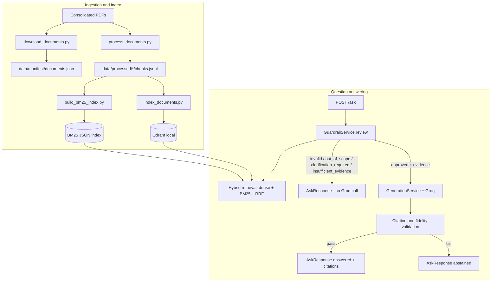

# Standards Q&A Assistant — Citation-Backed RAG

An AI-powered regulatory question-answering system over **official consolidated RoHS and REACH texts**. The pipeline retrieves evidence from a local index, applies deterministic scope and evidence guardrails, generates answers with Groq when evidence is sufficient, **resolves citations on the server**, and **abstains or rejects** when the question is out of scope or the evidence does not support a grounded answer.

Ordinary LLM chat is a weak fit for legal-style corpora: models can sound authoritative without tied evidence, blend instruments, or invent article references. This project treats **retrieved chunk text as the only permitted source** for generation, keeps **regulation and article/annex filters** in retrieval, and returns **structured statuses** (`answered`, `abstained`, `insufficient_evidence`, `clarification_required`, `out_of_scope`, `invalid`) instead of always forcing a narrative answer.

**This is not legal advice** and **not a live compliance database**. It reflects the consolidated document versions ingested locally (see [Supported regulatory documents](#supported-regulatory-documents)).

### On this page

[Quick start](#quick-start) · [Features](#key-features) · [Architecture](#architecture) · [Setup](#setup-and-installation) · [API](#run-the-api) · [Evaluation](#evaluation-and-results) · [Limitations](#limitations-and-responsible-use)

---

## Quick start

For a local checkout on Windows (PowerShell). `POST /ask` needs ingested PDFs, a Qdrant collection, a BM25 index, and Groq credentials in `.env`—see [Document processing and indexing](#document-processing-and-indexing) and [Setup and installation](#setup-and-installation).

**Install and run offline tests** (no Groq or RAGAS calls):

```powershell
py -3.11 -m venv .venv
.\.venv\Scripts\Activate.ps1
python -m pip install --upgrade pip
pip install -r requirements-dev.txt
copy .env.example .env
pytest
```

**After indexing** (`index_documents.py` and `build_bm25_index.py`), set `GROQ_API_KEY` and `GROQ_MODEL` in `.env`, then:

```powershell
uvicorn app.main:app --host 127.0.0.1 --port 8000
Invoke-RestMethod -Uri "http://127.0.0.1:8000/ready"
```

```powershell
$body = @{ question = "What does RoHS Article 4(1) require?" } | ConvertTo-Json
Invoke-RestMethod -Uri "http://127.0.0.1:8000/ask" -Method Post -Body $body -ContentType "application/json"
```

Full clone and environment steps: [Setup and installation](#setup-and-installation).

---

## Key features

| Area | What is implemented |
| --- | --- |
| **Ingestion** | Download and verify official EUR-Lex / Publications Office PDFs; manifest with checksums |
| **Extraction** | PyMuPDF text extraction, running-header cleanup, hierarchy detection (articles, annexes) |
| **Chunking** | Structure-aware chunks with overlap inside the same article or annex |
| **Embeddings** | `sentence-transformers/all-MiniLM-L6-v2` (384-d), local CPU/CUDA |
| **Vector store** | On-disk **Qdrant** collection `regulatory_documents` (cosine) |
| **Dense retrieval** | Query embedding + filtered semantic search |
| **Lexical retrieval** | **Okapi BM25** index in `storage/bm25/index.json` (project implementation, not Elasticsearch) |
| **Hybrid search** | Dense + BM25 candidates fused with **reciprocal rank fusion** (`RETRIEVAL_RRF_K`, default 60) |
| **Filtering** | Regulation, document, article, and annex payload filters |
| **Guardrails** | Deterministic classification (no LLM): supported / ambiguous / unsupported / invalid; evidence sufficiency |
| **Generation** | LangChain + **Groq**; JSON answer + chunk IDs; temperature default 0 |
| **Citations** | Backend copies metadata from retrieved chunks; invalid IDs reject the answer |
| **Validation** | Fidelity checks (numbers, lists, conditions); validation failure → `abstained`, no leaked rejected text |
| **API** | FastAPI: `GET /`, `GET /health`, `GET /ready`, `POST /ask` |
| **Web UI** | React + Vite app in `frontend/` (proxied to the API in dev) |
| **Evaluation** | RAGAS 0.4.4 end-to-end metrics; separate guardrail and retrieval benchmarks |

---

## Architecture



Guardrails run **before** generation. Only `approved` questions with retrieved context invoke the language model.

---

## Technology stack

| Component | Implementation | Version (pinned in repo) |
| --- | --- | --- |
| Language | Python | 3.11 (`.python-version`) |
| API | FastAPI | 0.162.6 |
| ASGI server | Uvicorn | 0.54.0 |
| Settings / validation | Pydantic, pydantic-settings | 2.14.3 / 2.16.3 |
| PDF | PyMuPDF | 1.26.7 |
| Embeddings | Sentence Transformers | 6.3.0 |
| Vector DB | Qdrant client (local path) | 1.20.0 |
| Orchestration | LangChain (core, Qdrant, Groq) | 1.8.0 / 1.1.0 / 1.1.3 |
| LLM inference | Groq API | via `langchain-groq` |
| Lexical search | In-repo Okapi BM25 | `app/retrieval/bm25.py` |
| Evaluation | RAGAS | 0.4.4 (`requirements-eval.txt`) |
| Tests | pytest, httpx | 8.4.2 / 0.28.1 |

---

## Supported regulatory documents

The knowledge base uses **official consolidated English PDFs**, not unofficial copies. Authentic legal texts remain the acts published in the Official Journal; consolidated versions are documentation tools.

| | RoHS | REACH |
| --- | --- | --- |
| Instrument | Directive 2011/65/EU | Regulation (EC) No 1907/2006 |
| CELEX | `02011L0065-20260701` | `02006R1907-20260622` |
| Consolidation | 01/07/2026, version 023.001 | 22/06/2026, version 069.001 |
| Local file | `data/raw/rohs/CL2011L0065EN0230010.0001.pdf` | `data/raw/reach/CL2006R1907EN0690010.0001.pdf` |

Checksums, source URLs, and download metadata are recorded in `data/manifest/documents.json` after `scripts/download_documents.py`. Later EU acts may exist on EUR-Lex that are **not** merged into these consolidated files; this corpus does not claim to include amendments published after consolidation unless you re-download and re-process.

---

## Project structure

```text
app/
  main.py                 Application factory and server entrypoint
  api/                    Routes, dependencies, exception handlers
  ask/                    POST /ask orchestration
  core/                   Settings, logging, exceptions
  documents/              Download, manifest, validation
  processing/             Extract, clean, chunk PDFs
  indexing/               Embeddings and Qdrant upsert
  retrieval/              Dense, BM25, RRF, filters
  guardrails/             Classification and evidence checks
  generation/             Groq generation and backend citations
  evaluation/             RAGAS helpers and report builders
  schemas/                API request/response models
evaluation/               Curated question sets and reports/
scripts/                  CLI: download, process, index, evaluate
tests/                    Pytest suite (174 tests)
data/                     PDFs, manifest, processed JSONL (gitignored)
storage/                  Qdrant, BM25 index, embedding cache (gitignored)
```

Business logic lives outside route handlers. Configuration is environment-driven (`pydantic-settings`). Errors return JSON with `error` and `message` fields.

---

## Setup and installation

**Requirements:** Python 3.11 and pip.

```powershell
git clone https://github.com/your-org/standards-qa-assistant.git
cd standards-qa-assistant
py -3.11 -m venv .venv
.\.venv\Scripts\Activate.ps1
python -m pip install --upgrade pip
pip install -r requirements-dev.txt
copy .env.example .env
```

Runtime packages are in `requirements.txt`; `requirements-dev.txt` adds **pytest** and **httpx** for tests. For RAGAS evaluation only:

```powershell
pip install -r requirements-eval.txt
```

Edit `.env` (never commit it). Minimum for live answers:

| Variable | Purpose |
| --- | --- |
| `GROQ_API_KEY` | Groq API key for generation |
| `GROQ_MODEL` | Chat model your account can call |
| `GROQ_TEMPERATURE` | Default `0` |

Retrieval and indexing paths, hybrid depths, BM25 parameters, and RAGAS judge settings are documented in **`.env.example`** (`QDRANT_PATH`, `RETRIEVAL_*`, `BM25_*`, `RAGAS_EVALUATOR_MODEL`, optional `RAGAS_SCORE_IDS`, etc.).

---

## Document processing and indexing

From the project root with the venv activated:

```powershell
# 1. Download PDFs and write manifest
python scripts/download_documents.py
python scripts/verify_documents.py

# 2. Extract, clean, chunk (does not modify PDFs)
python scripts/process_documents.py

# 3. Embed chunks and upsert into local Qdrant (idempotent UUID5 point IDs)
python scripts/index_documents.py

# 4. Build BM25 index for hybrid retrieval
python scripts/build_bm25_index.py
```

Outputs include `data/processed/{rohs,reach}/chunks.jsonl` and reports under `data/processed/*/extraction_report.json`. Re-indexing updates existing points when chunk IDs are unchanged; embedding cache avoids re-encoding identical text.

Measured chunk counts from the consolidated PDFs used in development: **273** RoHS and **1,745** REACH chunks (**2,018** vectors total).

---

## Web frontend

The `frontend/` directory is a **React + TypeScript + Vite** UI that talks to the same FastAPI endpoints. It uses **Tailwind CSS** and **lucide-react** icons. Development traffic is proxied to the API so CORS is not required.

**Install (once):**

```powershell
cd frontend
npm install
```

**Run locally (two terminals):**

```powershell
# Terminal 1 — API (from repo root, venv active)
uvicorn app.main:app --host 127.0.0.1 --port 8000
```

```powershell
# Terminal 2 — UI
cd frontend
npm run dev
```

- **Frontend URL:** [http://127.0.0.1:5173](http://127.0.0.1:5173)
- **Proxied API paths:** `POST /ask`, `GET /health`, `GET /ready` → `http://127.0.0.1:8000`
- **Production build:** `cd frontend && npm run build` (output in `frontend/dist/`)
- **Frontend tests:** `cd frontend && npm test`

The UI displays only fields returned by `AskResponse` and `ReadinessResponse` (answers, statuses, citations, clarification prompts, and generation metadata when present).

---

## Run the API

```powershell
uvicorn app.main:app --host 127.0.0.1 --port 8000
```

Or: `python -m app.main` (uses `API_HOST` / `API_PORT` from settings).

| Endpoint | Description |
| --- | --- |
| `GET /` | Project name, version, description, environment |
| `GET /health` | Liveness (`status`, `version`); does not call Groq |
| `GET /ready` | Local Qdrant + BM25 availability (`ready` / `not_ready`) |
| `POST /ask` | Guardrails → optional generation → `AskResponse` |

In `APP_ENV=production`, `/docs`, `/redoc`, and `/openapi.json` are disabled.

### `POST /ask`

**Request** (`AskRequest`):

```json
{
  "question": "What does RoHS Article 4(1) require?"
}
```

**Example answered shape** (`AskResponse` — fields vary by status):

```json
{
  "question": "What does RoHS Article 4(1) require?",
  "status": "answered",
  "answer": "…",
  "reason": null,
  "clarification_question": null,
  "citations": [
    {
      "chunk_id": "02011L0065-20260701:00022",
      "document_id": "02011L0065-20260701",
      "regulation": "RoHS",
      "regulation_number": "2011/65/EU",
      "article": "4",
      "paragraph": "1",
      "subparagraph": null,
      "annex": null,
      "page_start": 8,
      "page_end": 8,
      "source_filename": "CL2011L0065EN0230010.0001.pdf"
    }
  ],
  "abstention_reason": null,
  "generation_metadata": {
    "evidence_chunk_count": 1,
    "validated_citation_count": 1,
    "abstained": false,
    "latency_ms": 1200.0,
    "temperature": 0.0
  }
}
```

**Clarification** (`status`: `clarification_required`): includes `clarification_question`; no answer or citations.

**Unsupported** (`status`: `out_of_scope`): includes `reason`; no Groq call.

**Errors:** missing `GROQ_API_KEY` → HTTP **503**; provider failure → **502** (`ErrorResponse` with `error`, `message`).

**PowerShell example:**

```powershell
$body = @{ question = "What does RoHS Article 4(1) require?" } | ConvertTo-Json
Invoke-RestMethod -Uri "http://127.0.0.1:8000/ask" -Method Post -Body $body -ContentType "application/json"
```

---

## Example questions

| Type | Example | Expected behavior |
| --- | --- | --- |
| Supported RoHS | `What does RoHS Article 4(1) require?` | Retrieve RoHS evidence; may return `answered` with citations |
| Supported REACH | `What is the aim of REACH Article 1?` | Retrieve REACH evidence; may return `answered` with citations |
| Ambiguous | `What are the restrictions on lead?` | `clarification_required` (RoHS vs REACH) |
| Unsupported | `What are GDPR data retention requirements?` | `out_of_scope` |

Actual answers depend on retrieval scores and validation; the table describes **guardrail routing**, not guaranteed text.

---

## Evaluation and results

Three curated artifacts are used. **Question lists and counts differ by purpose**—do not merge them into one headline score.

| Evaluation | Question file | Questions run | What the headline counts mean |
| --- | --- | ---: | --- |
| **RAGAS (end-to-end)** | `evaluation/ragas_questions.json` | **50** through the live pipeline | **35** rows produced an answer with retrieved context and received **all four** RAGAS metrics; **15** ended without a scoreable answer |
| **Guardrails (classification)** | `evaluation/guardrail_questions.json` | **50** (different questions from RAGAS) | Routing accuracy on supported / ambiguous / unsupported labels |
| **Offline pytest** | `tests/` | **174** collected | No live Groq or RAGAS in the default suite |

**Saved reports (measured run, 2026-11-16):**

- [RAGAS report (Markdown)](evaluation/reports/ragas_report.md) · [RAGAS report (JSON)](evaluation/reports/ragas_report.json)
- [Guardrail report (JSON)](evaluation/guardrail_report.json)

### RAGAS — 50-question pipeline, 35 scored answers

Measured on the live stack (Qdrant, BM25, guardrails, Groq generation). Judge: `qwen/qwen3.8-27b`; RAGAS **0.4.4**.

| Outcome | Count | Notes |
| --- | ---: | --- |
| Curated dataset | 50 | 25 RoHS, 25 REACH — `ragas_questions.json` |
| Pipeline executed | 50 | One live run per curated id |
| **Answered** (generation path) | **35** | Eligible for RAGAS if context was returned |
| Abstained | 7 | Among the 50 pipeline rows |
| Insufficient evidence | 7 | Among the 50 pipeline rows |
| Clarification required | 1 | Among the 50 pipeline rows |
| **RAGAS: all four metrics** | **35 / 35** | Only the **35** answered rows; not 35 of 50 |
| RAGAS evaluation failures | 0 | On the final scored rows |

**RAGAS means apply to those 35 scored answers only.** The other 15 pipeline outcomes stay in the report with null metrics (abstention, insufficient evidence, or clarification).

| Metric | Mean (rounded in report) |
| --- | ---: |
| Faithfulness | 0.879 |
| Answer relevancy | 0.539 |
| Context precision | 0.954 |
| Context recall | 1.000 |

Reproduce (requires `GROQ_API_KEY`, `GROQ_MODEL`, `RAGAS_EVALUATOR_MODEL`):

```powershell
pip install -r requirements-eval.txt
python scripts/evaluate_ragas.py
```

Resume files: `evaluation/reports/ragas_intermediate.jsonl`, `evaluation/reports/ragas_scores.jsonl`. Optional: `RAGAS_SCORE_IDS`, `RAGAS_SKIP_GUARDRAIL_REPORT=1`.

### Guardrails — separate 50-question set

`evaluation/guardrail_questions.json` is **not** the RAGAS list. Metrics describe **routing on this file only**.

| Bucket | Questions in file | Measured rate (curated run) |
| --- | ---: | ---: |
| Supported | 20 | Acceptance 1.00 |
| Ambiguous | 15 | Clarification 1.00 |
| Unsupported | 15 | Rejection 1.00 |
| False acceptance | — | 0.00 |
| False rejection | — | 0.00 |

```powershell
python scripts/evaluate_guardrails.py
```

Curated benchmarks only—not a guarantee on arbitrary real-world questions.

### Offline tests

```powershell
pytest
```

| | Count |
| --- | ---: |
| Collected | 174 |
| Passed | 173 |
| Failed | 0 |
| Skipped | 1 (`tests/test_generation_live.py` when `GROQ_API_KEY` / `GROQ_MODEL` unset in the environment) |
| Exit code | 0 |

Other evaluation scripts: `scripts/evaluate_retrieval.py`, `scripts/evaluate_evidence_quality.py`.

---

## Limitations and responsible use

- Coverage is limited to **ingested RoHS and REACH consolidations** and indexed chunks; tables and cross-references may be imperfect in PDF extraction.
- Outputs are **informational**, not a substitute for counsel or official sources (EUR-Lex, ECHA).
- Retrieval can miss relevant chunks; generation can still omit qualifications despite fidelity checks.
- **Answer relevancy** (0.539 in RAGAS) indicates room to improve question–answer alignment.
- Guardrail metrics come from a **small, hand-written** set.
- Citation validation ensures cited chunk IDs were in the evidence set; it does **not** certify every legal interpretation.

---

## Future improvements

- Improve answer relevancy and question-to-answer alignment
- Expand evaluation sets and harder negative examples
- Improve retrieval recall and hybrid ranking
- Document version update and re-ingestion workflows
- Additional regulatory frameworks
- Richer table and layout handling in PDF extraction

These items are **not** implemented today.

---

## License

No `LICENSE` file is present in this repository. **No license has been specified yet.**

---

## Additional reference

Environment defaults: [`.env.example`](.env.example). Interactive API docs: `http://127.0.0.1:8000/docs` when `APP_ENV` is not `production`. Chunking, TLS download notes, retrieval cutoff behavior, and generation validation rules are described in the sections above; they are measured behaviors on the ingested corpus, not universal guarantees.